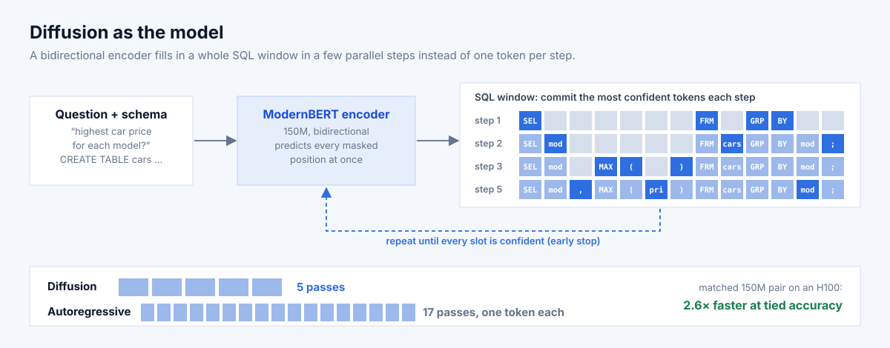
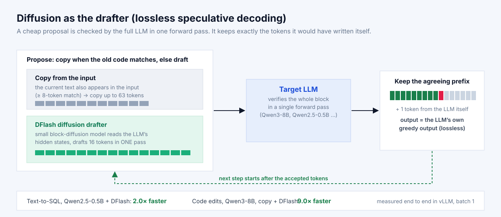
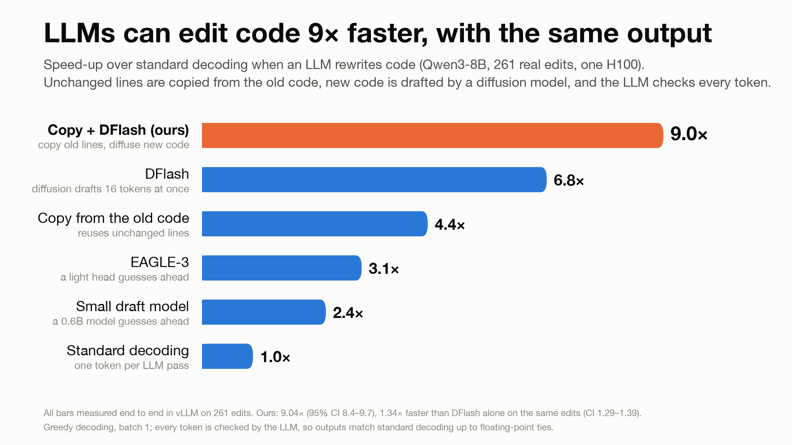

<p align="center">
  <a href="https://diffusion.lethonium.com/"></a>
</p>

# Diffusion-LLM

Diffusion can make language models faster in two ways, and this repo studies both:

1. **As the model.** A masked diffusion language model (ModernBERT, LLaDA-style) writes a whole SQL query in a few
   parallel denoising steps instead of one token at a time.
2. **As the drafter.** A small diffusion drafter proposes a block of tokens in one pass, and a regular LLM checks the
   whole block at once. The output stays exactly what the LLM would have written; on code edits it arrives 9× faster.

**Live demo: [diffusion.lethonium.com](https://diffusion.lethonium.com/)**: type a question and a schema, and watch the
SQL denoise step by step, with token confidence and early stop.

## Results at a glance

| | Setup | Result | Write-up |
|---|---|---|---|
| Diffusion as the model | Ettin-150M encoder (diffusion) vs. the matching Ettin-150M decoder (AR), text-to-SQL, H100 | **2.6× faster** at tied accuracy | [GPU session 2](experiments/2026-10-14_gpu-session-2/README.md) |
| Diffusion as the drafter, SQL | Qwen2.5-0.5B + DFlash drafter in vLLM | **2.0× faster**, same accuracy; 1.3× faster than an EAGLE-3 drafter | [GPU session 2](experiments/2026-10-14_gpu-session-2/README.md) |
| Diffusion as the drafter, code edits | Qwen3-8B + copy + DFlash router (vLLM plugin), H100 | **9.0× faster** than plain decoding (95% CI 8.4–9.7), 1.34× faster than DFlash alone | [Code-edit study](experiments/2026-11-23_generalization/README.md) |

All speeds are measured end to end at batch 1. Every experiment folder has its scripts, raw data and plots; the
index is [`experiments/README.md`](experiments/README.md).

## 1. Diffusion as the model: text-to-SQL



The SQL window starts fully masked. Each step, the encoder predicts every masked position at once and commits the most
confident tokens; easy queries stop early. ModernBERT-base (150M), 10 epochs on
[`gretelai/synthetic_text_to_sql`](https://huggingface.co/datasets/gretelai/synthetic_text_to_sql), confidence
decoding with adaptive early stop at 0.9, first 256 filtered test rows:

| Metric | Value |
|---|---|
| Semantic accuracy (LLM judge) | **0.50** |
| Exact string match | 0.32 |
| Avg. denoising steps (forward passes) | 11.8, vs ~30 tokens for autoregressive decoding |
| Largest failure mode | invalid SQL (~14%) |

Compared with an autoregressive (AR) model fine-tuned on the same data ([Qwen experiment](experiments/2026-07-05_qwen-ar-diffusion/README.md), same 256 rows, same LLM judge):

| Model | Params | Semantic accuracy | Forward passes |
|---|---:|---:|---:|
| AR: Qwen2.5-Coder-0.5B SFT | 500M | **0.645** | ~30 (one per token) |
| Diffusion: ModernBERT-base (this repo's main model) | 150M | 0.500 | 11.8 |
| Diffusion: Qwen2.5-Coder-0.5B adapted to masked diffusion | 500M | 0.191 | 11.8 |

- **Matched size, diffusion is 2.6× faster at tied accuracy.** Ettin-150M encoder (diffusion) vs. decoder (AR), same data, 10 epochs, 1,000 test queries on one H100: 25 ms (CUDA graphs) vs 67 ms (vLLM), exec 0.564 vs 0.580 (−1.7 ± 3.5, a tie), exact match 0.277 vs 0.239 (+3.8 ± 2.3). Diffusion's gap is invalid SQL (−10 points), mostly closed by one verify pass (exec 0.591, 42 ms). See [GPU session 2](experiments/2026-10-14_gpu-session-2/README.md) and [session 1](experiments/2026-10-12_gpu-session/README.md).
- **Adaptive early stop is the main speed lever.** It cuts forward passes 1.8–3× with no quality loss (see [Decoding efficiency](#decoding-efficiency-steps-vs-autoregressive)).
- **More steps can hurt.** Accuracy peaks around 11 steps (threshold 0.9) and falls ~10 points when decoding runs to a 0.99 threshold (~19 steps).
- **PAPL fine-tuning only saves steps.** It gives ~7% fewer steps at equal accuracy ([PAPL A/B](experiments/2026-06-30_papl-ab/README.md)).
- **On CPU (the hosted setup), AR is still the better trade.** Cheap changes make diffusion 2.1× faster, but a 3.3× larger AR model matches its fp32 latency at higher accuracy ([fair CPU benchmark](experiments/2026-10-09_fair-cpu-benchmark/README.md), [roadmap](docs/roadmap.md)).
- **Dependency-ordered decoding (DOS) does not beat confidence ordering** on this model (see [below](#commit-ordering-confidence-vs-dependency-dos)).

## 2. Diffusion as the drafter: lossless speculative decoding



Speculative decoding keeps a regular LLM as the authority: a cheap proposer guesses the next tokens, the LLM checks
all of them in one forward pass and keeps exactly the prefix it agrees with, plus one token of its own. With greedy
decoding the output is the LLM's own output; only the number of LLM passes changes. A block-diffusion drafter
([DFlash](https://github.com/z-lab/dflash)) guesses 16 tokens in a single pass, which is what makes it cheap.

- **Text-to-SQL: 2.0× faster at unchanged accuracy.** Qwen2.5-0.5B (exec 0.735) on vLLM with a 3-layer DFlash drafter: 28 ms instead of 57 ms, and 1.3× faster than an EAGLE-3 drafter trained on the same data (37 ms). Above 150M, diffusion as the drafter beats diffusion as the model: Ettin-400M diffusion takes 32 ms at exec 0.606. ([GPU session 2](experiments/2026-10-14_gpu-session-2/README.md))
- **Code edits: 9.0× faster with the same output.** Most of an edited file is unchanged. A router copies it straight
  from the input when the current text matches the old code (up to 63 tokens per pass) and lets DFlash draft only the
  new code. Built as a vLLM plugin ([`copyflash_plugin/`](experiments/2026-11-23_generalization/copyflash_plugin/)); on
  Qwen3-8B and 261 real edits it runs 9.0× faster than plain decoding, 1.34× faster than DFlash alone, and held up
  on Qwen3-4B (8.8×) with the settings fixed.



The gain depends on how much of the file an edit leaves unchanged: from 6× when under half the output is old code to
about 19× when almost all of it is ([curves](experiments/2026-11-23_generalization/figures/curves_qwen3-8b.png)). On
bug fixes in short programs and on diff-style output it adds little over DFlash (1.02× and 1.10×). Details, caveats
and the path from Mac audits to the H100 runs:
[copy audit](experiments/2026-11-21_copy-audit/README.md) →
[DFlash on edits](experiments/2026-11-21_dflash-mlx/README.md) →
[A100 benchmark](experiments/2026-11-22_h100-bench/README.md) →
[vLLM router, H100](experiments/2026-11-23_generalization/README.md).

## Repository layout

```
src/
  train.py              LLaDA-style training (ModernBERT, 1/t-weighted ELBO)
  denoising.py          confidence / dependency decoding shared by eval and UIs
  inference.py          Flask playground + API (what the live demo runs)
  gradio_inference.py   minimal local Gradio UI
  finetune_papl.py, bench_papl.py, dump_predictions.py, compare_strategies.py, sql_repair.py, augment.py
bench/                  fair diffusion-vs-AR benchmark (quality + latency, same engine)
experiments/            dated write-ups with scripts, data, predictions and plots (index: experiments/README.md)
  2026-11-23_generalization/copyflash_plugin/   copy + DFlash router as a vLLM speculative-decoding plugin
docs/                   roadmap, GPU session runbooks, deployment, README graphics (docs/assets)
scripts/                GPU training / A/B launch scripts, qualitative eval
docker/, Dockerfile, docker-compose.yml   CPU deployment (web + worker + redis)
checkpoints/            model weights (gitignored)
```

## How the diffusion model works

### Training (`src/train.py`)

- Backbone: `answerdotai/ModernBERT-base` with an MLM head.
- Inputs are built at the token level:
  `[CLS] <PROMPT> ... </PROMPT> <CONTEXT> ... </CONTEXT> <SQL> sql + [PAD]s </SQL> [SEP]`
  The SQL span is a fixed 128-token window; `[PAD]` tokens inside it are real
  prediction targets, so the model learns output length.
- Forward (noising) process: per example a continuous mask ratio `t ~ U(0, 1]`
  is drawn and each SQL-span token is masked independently with probability `t`.
- Loss: cross-entropy on masked positions weighted by `1/t` (the discrete
  diffusion ELBO). This properly trains the fully-masked regime that
  generation starts from.
- Eval: besides MLM loss, generation-based exact match is computed by actually
  denoising validation examples (`eval/generation_exact_match` in wandb).

### Inference (`src/denoising.py`)

Confidence-based iterative unmasking (MaskGIT/LLaDA decoding):

1. The SQL window starts fully masked.
2. Each step predicts only the currently masked positions.
3. The most confident predictions are committed permanently (cosine schedule:
   few commits early, more as context fills in).
4. Committed tokens are never resampled, so generation converges instead of
   flickering. `top_k > 1` adds Gumbel noise to the commit order for diversity.
5. **Adaptive early stop** (on by default): on each step, any masked position
   whose top-token probability is already `>= confidence_stop` is also committed,
   so easy queries empty the window in far fewer forward passes. The step slider
   becomes a *maximum*; the actual number of steps adapts to difficulty.

### Decoding efficiency (steps vs. autoregressive)

Each diffusion step is one forward pass over the whole sequence but commits many
tokens at once, whereas autoregressive decoding needs roughly one forward pass
per output token. Measured with `scripts/inspect_eval.py` on 58 held-out examples
(8 sanity + 50 gretelai test), greedy decoding, 128-token SQL window:

**Fixed steps** (no early stop) — accuracy plateaus around 12–16 steps; beyond
that adds cost without quality, and at 24 steps the model needs *more* passes
than autoregressive would:

| steps | exact | soft (Jaccard ≥ .9) | speedup vs. autoregressive |
|------:|:-----:|:-------------------:|:--------------------------:|
| 4     | 0.50  | 0.50  | 4.7× |
| 8     | 0.55  | 0.60  | 2.3× |
| 12    | 0.65  | 0.65  | 1.6× |
| 16    | 0.60  | 0.60  | 1.2× |
| 24    | 0.65  | 0.65  | 0.8× |

**Adaptive early stop** (cap = 16 steps) — fewer average passes *and* higher
accuracy, because committing confident tokens sooner gives the model better
context to resolve the rest:

| `confidence_stop` | exact | soft | avg steps used |
|:-----------------:|:-----:|:----:|:--------------:|
| off               | 0.328 | 0.345 | 16.0 |
| 0.95              | 0.362 | 0.379 | 10.0 |
| **0.90** (default)| **0.397** | **0.414** | **8.8** |

Easy queries finish in ~4 passes, hard ones use up to the cap. Defaults:
`default_steps = 20` (the cap; early stop adapts down from there),
`CONFIDENCE_STOP = 0.9`. Toggle per run in the playground's Advanced panel, or
globally via `--confidence-stop` / `CONFIDENCE_STOP` (set `0` to disable).

### Commit ordering: confidence vs. dependency (DOS)

`denoise_steps` supports an alternative `strategy="dependency"` that reorders
commits by a DOS-style ([arXiv:2603.15340](https://arxiv.org/abs/2603.15340))
attention-groundedness score: for each masked position, the fraction of its
attention mass (averaged over heads, read from a single tuned layer via
`dep_layer_index`) that lands on already-revealed context. The paper's intuition
is that committing the best-grounded tokens first respects inter-token
dependencies. `dep_alpha` blends it with confidence (1.0 = standalone DOS).

We evaluated it faithfully with `src/compare_strategies.py` on the gretelai
text-to-SQL test split (eager attention). **It does not beat the confidence
baseline on this model, across three tests:**

**1. Standalone DOS, single layer swept shallow→deep** (fixed 24 steps, n=128):

| layer read | exact | Δ vs baseline | latency |
|:--|:--:|:--:|:--:|
| **confidence (default)** | **0.242** | — | — |
| DOS layer 4 (best) | 0.250 | +0.008 (1 example) | +30% |
| DOS layers 0/2/6/8/10/21 | 0.195–0.234 | −0.008 to −0.047 | +22–30% |

The paper tunes the attention layer (favoring shallow, syntax-bearing layers);
sweeping layers 0–21 here, the best beats baseline by a single example (noise)
and most layers are *worse*. No layer redeems it.

**2. Under adaptive early-stop** (`confidence_stop=0.9`, n=256): DOS reaches the
threshold in fewer steps but commits the wrong tokens early —

| config | exact | avg steps | latency |
|:--|:--:|:--:|:--:|
| **confidence (default)** | **0.320** | 11.8 | 1017 ms/ex |
| DOS layer 4 (standalone) | 0.102 | 5.4 | 472 ms/ex |

It is ~2× faster only because it's a fast path to a **−0.219 accuracy** answer.

Why it doesn't transfer: DOS is training-free and can only exploit dependency
structure the model already encodes in attention. The paper's gains are on 7–8B
reasoning DLMs (LLaDA/Dream); this is a ~150M SQL-tuned ModernBERT encoder whose
attention carries little exploitable dependency signal — consistent with
standalone dependency being *worse* than confidence at every layer.

**Decision: confidence remains the default; DOS is not wired into the inference
frontend.** The dependency path stays opt-in (`strategy`/`dep_alpha`/`dep_layers`/
`dep_layer_index` args to `denoise_steps`, exercised by `compare_strategies.py`)
for future experimentation — e.g. against a larger or dependency-supervised
model. Note it also silently no-ops to confidence on the ONNX backend and on any
torch model not loaded with `attn_implementation="eager"`.

## Features

- LLaDA-style masked diffusion training with `1/t`-weighted ELBO loss.
- Confidence-based parallel decoding shared by training eval and both UIs.
- Adaptive confidence early-stopping: ~1.8–3× fewer forward passes with no
  quality loss (toggleable per run; see Decoding efficiency above).
- Generation-based exact-match eval logged to wandb during training.
- Public-ready Flask playground (`src/inference.py`) with SSE + polling fallback.
- Redis-backed queue + worker for stable queue position/ETA and run TTL.
- CPU safety controls for public deployment:
  - strict single-flight inference (default 1 active run)
  - bounded queue (default 3)
  - per-IP rate limits
  - request timeout and stale-run cleanup
  - GIF generation disabled by default

## Local Quickstart

### 1. Install dependencies

```bash
pip install -r requirements.txt
```

### 2. Train a model

```bash
python src/train.py
```

Checkpoints and the final model are written to `checkpoints/diffusion-sql-modernbert/`.
For a full GPU run see `scripts/run_gh200.sh`.
Track `eval/generation_exact_match` in wandb for actual generation quality.

### 3. Run inference UI locally

```bash
python src/inference.py --model-dir checkpoints/diffusion-sql-modernbert      # Flask playground (as hosted)
python src/gradio_inference.py --model-dir checkpoints/diffusion-sql-modernbert  # minimal Gradio UI
```

Both old (roberta) and new (ModernBERT) checkpoints load via the Auto classes.

## Deployment

The public playground runs on CPU behind a queue (web + worker + Redis). Docker and compose setup, runtime limits,
the public API, CLI options and CPU tuning: [docs/deployment.md](docs/deployment.md).

## License

[MIT](LICENSE)
