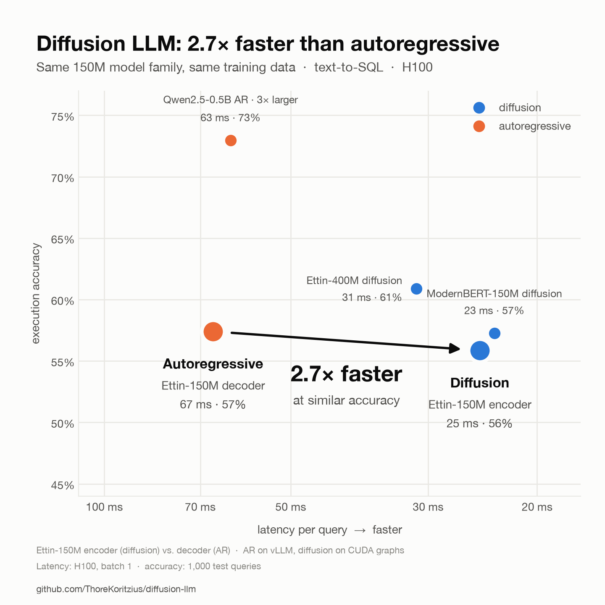
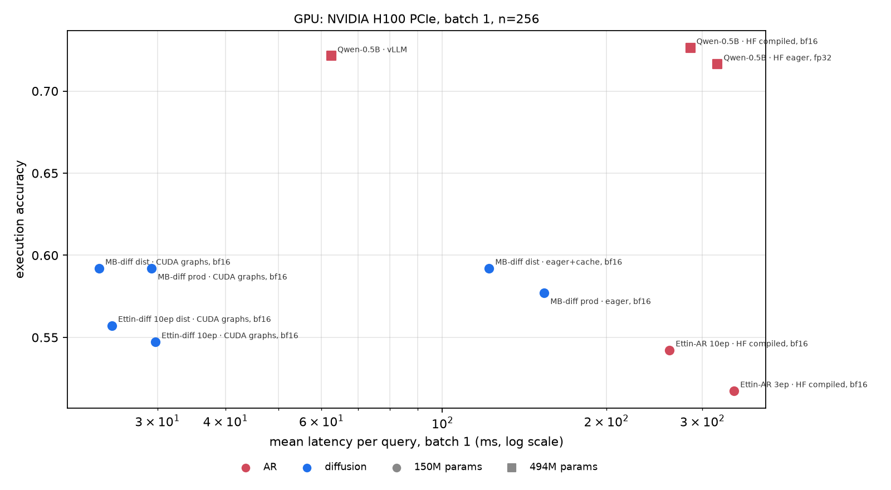
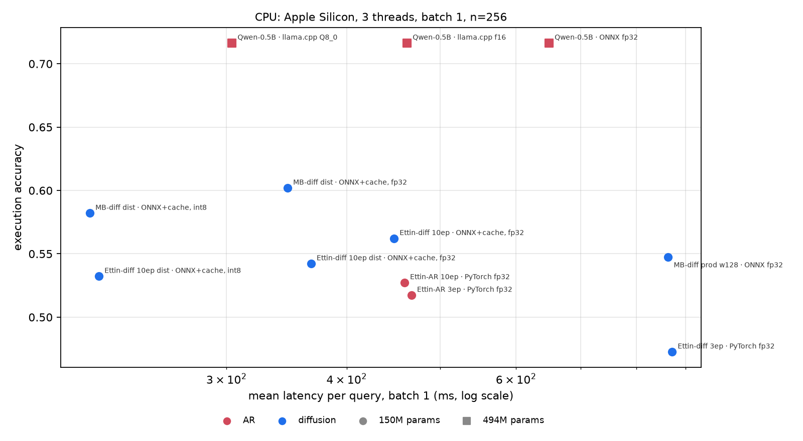

# GPU session: prompt caching, longer training, step distillation, CPU + GPU latency (2026-10-12)

One H100 PCIe session (~5 h 55 min, 07:36–13:31) plus CPU benchmarks on Apple Silicon. Every number below is on the
same 256 gretelai test rows (`bench/`, exec accuracy over the 201 rows whose gold SQL runs in SQLite, batch 1).

## TL;DR

1. **At matched size, diffusion is on par with AR, with different strengths.** Ettin-150M encoder (diffusion) vs.
   Ettin-150M decoder (AR), same pretraining data, same SQL data, 10 epochs each: exact match **0.324 vs 0.250**
   (about 2.6 standard errors, likely real), exec **0.562 vs 0.527** (about 1 standard error, a tie), and AR produces
   valid SQL more often (**0.73 vs 0.64**). Single seed per arm; see caveats.
2. **Diffusion needs more epochs; AR doesn't benefit.** 3 → 10 epochs: diffusion exec +8.9 points, exact +7.4;
   AR +1.0 / +0.8. At 3 epochs AR was ahead.
3. **Prompt caching is nearly free once trained for.** The one-way prompt mask costs ~3 points exec (within one
   standard error) after 2 epochs; the cache then cuts CPU latency by 29–37% with identical outputs.
4. **Step distillation** (trajectory masking + certainty forcing, `src/train.py`) cuts denoising steps 18–23%
   (9.5 → 7.4) at equal or better quality.
5. **GPU (batch 1), matched size, both optimized:** Ettin-150M AR in **vLLM takes 67 ms** per query (exec 0.537);
   Ettin-150M diffusion with CUDA graphs takes **25 ms** (exec 0.557): **2.7× faster, +2 points exec, +5 points
   exact**. vLLM runs the Ettin decoder through `vllm_plugin/` (upstreamed as vllm-project/vllm#61246). The 3.3×
   larger Qwen2.5-0.5B AR in vLLM takes 63 ms at exec 0.721.
6. **Ettin-400M diffusion** (10 epochs + distillation): exec **0.592** (+3.5 over 150M, about one standard error),
   exact 0.316, at **31 ms** on the GPU: 2.7× the parameters for about 25% more latency.
7. **CPU (3 threads):** distilled, cached, int8 diffusion runs in **216 ms**, vs. **304 ms** for Qwen2.5-0.5B AR in
   llama.cpp Q8_0, again at −13 points exec. Versus the playground's configuration at the start of this work
   (863 ms, exec 0.547) it is **4.0× faster and 3.5 points more accurate**.

The remaining quality gap to Qwen2.5-0.5B is model size and pretraining, not the decoding paradigm: at matched size
the diffusion model is on par or ahead.

## What was trained

| checkpoint | from | recipe | GPU time |
|---|---|---|---:|
| `modernbert-isolated` | main ModernBERT diffusion model | +2 epochs, one-way prompt mask | 19 min |
| `modernbert-ft-control` | main ModernBERT diffusion model | +2 epochs, full attention (control) | 19 min |
| `ettin150-diffusion` | `jhu-clsp/ettin-encoder-150m` | masked diffusion, 3 epochs | 29 min |
| `ettin150-ar` | `jhu-clsp/ettin-decoder-150m` | causal SFT, 3 epochs | 46 min |
| `ettin150-diffusion-iso-10ep` | `ettin150-diffusion` | +7 epochs, prompt mask | 132 min (parallel) |
| `ettin150-ar-10ep` | `ettin150-ar` | +7 epochs | 125 min (parallel) |
| `modernbert-isolated-distilled` | `modernbert-isolated` | +1 epoch, trajectory masking + certainty forcing (λ=0.5) | 30 min (parallel) |
| `ettin150-diffusion-iso-10ep-distilled` | `ettin150-diffusion-iso-10ep` | same | 30 min (parallel) |

All diffusion runs use effective batch 128; AR runs effective batch 64 (their original recipe). A planned Ettin-400M
pair and the Qwen3.5-0.8B AR baseline were stopped / skipped in favour of the longer-training and distillation runs.
Training curves: W&B project `sql-diffusion`.

## Results





### GPU (NVIDIA H100 PCIe, batch 1, n=256)

| configuration | params | exec | valid | exact | forward passes | p50 ms | p95 ms | mean ms |
|---|---:|---:|---:|---:|---:|---:|---:|---:|
| **AR** Qwen2.5-0.5B · vLLM | 494M | 0.721 | 0.805 | 0.363 | 30.1 | 50 | 146 | 63 |
| **AR** Qwen2.5-0.5B · HF static cache + compile, bf16 | 494M | 0.726 | 0.809 | 0.359 | 30.1 | 152 | 409 | 285 |
| **AR** Qwen2.5-0.5B · HF eager, fp32 | 494M | 0.716 | 0.805 | 0.355 | 29.9 | 264 | 717 | 320 |
| **AR** Ettin-150M, 10 ep · vLLM (`vllm_plugin/`) | 150M | 0.537 | 0.738 | 0.254 | 32.5 | 56 | 145 | 67 |
| **AR** SmolLM2-135M · vLLM | 135M | 0.418 | 0.711 | 0.191 | 38.1 | 60 | 177 | 74 |
| **AR** Ettin-150M, 10 ep · HF static cache + compile, bf16 | 150M | 0.542 | 0.742 | 0.254 | 33.3 | 197 | 517 | 261 |
| **AR** Ettin-150M, 3 ep · HF static cache + compile, bf16 | 150M | 0.517 | 0.730 | 0.246 | 32.6 | 192 | 501 | 343 |
| **Diffusion** Ettin-400M, 10 ep, distilled · CUDA graphs, bf16 | 396M | 0.592 | 0.680 | 0.316 | 7.3 | 22 | 68 | 31 |
| **Diffusion** Ettin-400M, 10 ep · CUDA graphs, bf16 | 396M | 0.597 | 0.660 | 0.324 | 8.9 | 30 | 68 | 38 |
| **Diffusion** ModernBERT, distilled · CUDA graphs, bf16 | 150M | 0.592 | 0.688 | 0.297 | 7.4 | 17 | 49 | 23 |
| **Diffusion** ModernBERT, distilled · PyTorch eager + prompt cache, bf16 | 150M | 0.592 | 0.691 | 0.301 | 7.4 | 98 | 245 | 122 |
| **Diffusion** Ettin-150M, 10 ep, distilled · CUDA graphs, bf16 | 150M | 0.557 | 0.648 | 0.305 | 7.8 | 17 | 49 | 25 |
| **Diffusion** Ettin-150M, 10 ep · CUDA graphs, bf16 | 150M | 0.547 | 0.629 | 0.320 | 9.6 | 28 | 49 | 30 |
| **Diffusion** ModernBERT, production model · CUDA graphs, bf16 | 150M | 0.592 | 0.688 | 0.312 | 9.4 | 29 | 49 | 29 |
| **Diffusion** ModernBERT, production model · PyTorch eager, bf16 | 150M | 0.577 | 0.668 | 0.305 | 9.4 | 160 | 266 | 154 |

### Accuracy on 1,000 queries (CPU fp32, same queries for every model)

The n=256 accuracies above have a standard error of about 3.5 points. These runs use 1,000 test rows (777 with
executable gold SQL); "vs Ettin AR" is the paired difference on the same queries, ± one standard error.

| model | exec | exact | valid SQL | exec when valid | exec vs Ettin AR | forward passes |
|---|---:|---:|---:|---:|---:|---:|
| **AR** Qwen2.5-0.5B (494M) | 0.730 | 0.336 | 0.956 | 0.763 | +15.6 ± 1.7 | 30.8 |
| **AR** Ettin-150M, 10 ep | 0.574 | 0.238 | 0.856 | 0.671 | – | 34.4 |
| **AR** Ettin-150M, 10 ep + verify 4 | 0.616 | 0.238 | 0.951 | 0.648 | +4.2 ± 0.7 | 72.4 |
| **Diffusion** Ettin-150M, 10 ep, distilled, window 64 | 0.559 | 0.279 | 0.750 | 0.744 | −1.5 ± 1.8 | 8.5 |
| **Diffusion** same, window 128 | 0.538 | 0.268 | 0.707 | 0.761 | −3.6 ± 1.8 | 8.6 |
| **Diffusion** same, window 64 + verify 4 | 0.611 | 0.281 | 0.879 | 0.695 | +3.7 ± 1.7 | 27.2 |
| **Diffusion** ModernBERT-150M, distilled, window 64 | 0.573 | 0.279 | 0.771 | 0.743 | −0.1 ± 1.8 | 8.2 |
| **Diffusion** Ettin-400M, 10 ep, distilled, window 64 | 0.609 | 0.300 | 0.797 | 0.764 | +3.5 ± 1.8 | 7.9 |

- At matched size, diffusion ties AR on exec (−1.5 ± 1.8) and leads on exact match (+4.1 ± 1.2). The n=256 "+2
  points exec" did not hold up.
- Diffusion's gap is validity (75% vs 86% valid SQL); when its SQL is valid it is correct more often (74% vs 67%).
  Invalid outputs are mostly garbled identifiers and literals from parallel unmasking.
- Verify-and-resample (`--verify 4`) adds about 4–5 points to both arms, so they still tie on exec (−0.5 ± 1.7);
  it costs diffusion 3.2× forward passes vs 2.1× for AR, which shrinks the speed lead.
- Ettin-400M beats Ettin-150M diffusion by +5.0 ± 1.5 exec on these queries: scale helps, modestly.
- A 128-token window is worse than 64: more padding positions to fill, more invalid SQL.

### CPU (Apple Silicon, 3 threads, batch 1, n=256)

| configuration | params | exec | valid | exact | forward passes | p50 ms | p95 ms | mean ms |
|---|---:|---:|---:|---:|---:|---:|---:|---:|
| **AR** Qwen2.5-0.5B · llama.cpp Q8_0 | 494M | 0.716 | 0.801 | 0.363 | 31.3 | 264 | 584 | 304 |
| **AR** Qwen2.5-0.5B · llama.cpp f16 | 494M | 0.716 | 0.805 | 0.355 | 30.9 | 400 | 906 | 462 |
| **AR** Qwen2.5-0.5B · ONNX Runtime fp32 (KV cache) | 494M | 0.716 | 0.805 | 0.355 | 29.9 | 543 | 1395 | 649 |
| **AR** Ettin-150M, 10 ep · PyTorch fp32 (KV cache) | 150M | 0.527 | 0.734 | 0.250 | 32.2 | 385 | 870 | 459 |
| **AR** Ettin-150M, 3 ep · PyTorch fp32 (KV cache) | 150M | 0.517 | 0.719 | 0.242 | 32.3 | 380 | 904 | 467 |
| **Diffusion** ModernBERT, distilled · ONNX + prompt cache, int8 | 150M | 0.582 | 0.688 | 0.297 | 7.5 | 168 | 444 | 216 |
| **Diffusion** ModernBERT, distilled · ONNX + prompt cache, fp32 | 150M | 0.602 | 0.695 | 0.309 | 7.4 | 253 | 757 | 347 |
| **Diffusion** Ettin-150M, 10 ep, distilled · ONNX + prompt cache, int8 | 150M | 0.532 | 0.625 | 0.285 | 8.1 | 175 | 429 | 221 |
| **Diffusion** Ettin-150M, 10 ep, distilled · ONNX + prompt cache, fp32 | 150M | 0.542 | 0.629 | 0.305 | 7.8 | 271 | 747 | 367 |
| **Diffusion** Ettin-150M, 10 ep · ONNX + prompt cache, fp32 | 150M | 0.562 | 0.637 | 0.324 | 9.6 | 447 | 771 | 448 |
| **Diffusion** Ettin-150M, 3 ep · PyTorch fp32 | 150M | 0.473 | 0.598 | 0.250 | 10.5 | 882 | 1840 | 872 |
| **Diffusion** ModernBERT, production config (window 128) · ONNX fp32 | 150M | 0.547 | 0.582 | 0.309 | 9.5 | 803 | 1734 | 863 |

Prompt isolation (trained, GPU eval): control 0.582 exec / isolated 0.552 exec (exact 0.301 / 0.293).

## Caveats

- **Statistics.** n=256 (201 for exec): one standard error is ~3.5 points exec and ~2.8 points exact. The matched-size
  exec gap (+3.5) is about one standard error; the exact-match gap (+7.4) is about 2.6. One seed per arm, so
  seed-to-seed variance is not measured.
- **Is the AR plateau real?** Yes, as far as these runs show: AR keeps training (eval loss 0.319 → 0.30, outputs and
  exec change between evals) but its train loss stays at ~0.32 from epoch 3 to 10. Both arms used the same
  augmentation, cosine schedule and learning rate per batch size (AR 5e-5 @ 64, diffusion 1e-4 @ 128, both halved
  for the continuation). AR hyperparameters were not tuned; a higher AR learning rate was not tested.
- **Why diffusion keeps improving.** Each epoch shows a diffusion model every example under a new random mask and mask
  ratio, so repeated data keeps yielding new prediction tasks; AR sees each example in the same left-to-right order.
  This matches published findings that masked diffusion benefits from many more epochs on limited data.
- **Matched-size AR engines.** On GPU, Ettin AR runs in vLLM through `vllm_plugin/` (outputs match Hugging Face;
  exec 0.537 vs 0.542). On CPU, llama.cpp does not support the Ettin decoder, so the fastest CPU AR number is still
  the 3.3× larger Qwen2.5-0.5B. Diffusion runs on hand-written CUDA graphs: no serving engine exists for masked
  diffusion, so the GPU comparison still favours AR's tooling.
- **CUDA-graph p95 (49 ms)** is dominated by the first query of each new padded length, which captures a graph;
  p50 is representative of steady state.
- **Distillation confound:** the distilled models also got one more epoch, which may explain part of the
  ModernBERT quality gain.
- **CPU timings** come from a Mac, not the Linux CPU host that serves the playground; relative numbers transfer
  better than absolute ones.
- One dataset (synthetic, ~30-token SQL). Short outputs are the hardest case for diffusion speed.

## Next

1. **Playground:** deploy `modernbert-isolated-distilled` with the ONNX prompt cache (int8), about 4× faster than
   today at higher accuracy. Needs the cached ONNX path in `src/inference.py` (it exists in `bench/`).
2. **Fair matched-size speed:** a small AR model that vLLM and llama.cpp support (e.g. a ~150M Llama/Qwen-architecture
   model) trained on the same data, or a llama.cpp port of the Ettin decoder.
3. **Scale and quality:** Ettin-400M with the 10-epoch recipe, then execution-reward RL; a longer-output or SQL
   editing task where parallel decoding has more room.

## Reproduce

```bash
python experiments/2026-10-12_gpu-session/make_report.py   # tables + plots from data/
bash scripts/run_gpu_session.sh / run_gpu_phase2.sh / run_gpu_distill.sh / run_gpu_bench.sh   # on the GPU
```
