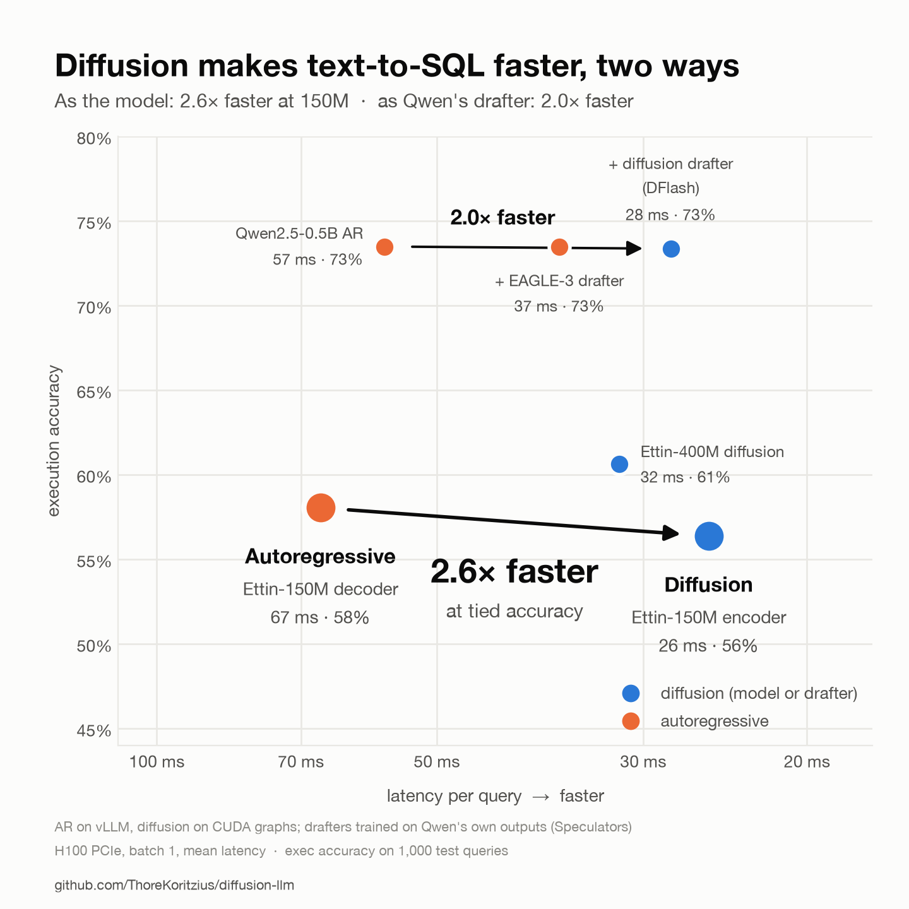

# GPU session 2: speculative decoding with a diffusion drafter, matched pair on one GPU (2026-10-14)

One H100 PCIe, 09:29–12:13 (~2 h 45 min), [`scripts/run_gpu_session2.sh`](../../scripts/run_gpu_session2.sh). Every
number below is from this GPU: batch 1, the same 1,000 test queries (exec accuracy over the 777 whose gold SQL runs in
SQLite), so accuracy and latency come from the same runs.

## TL;DR

1. **Matched size, diffusion is 2.6× faster at tied accuracy.** Ettin-150M encoder (diffusion, CUDA graphs) vs.
   Ettin-150M decoder (AR, vLLM): 25.5 vs 66.7 ms mean, exec 0.564 vs 0.580 (−1.7 ± 3.5, a tie), exact match
   0.277 vs 0.239 (**+3.8 ± 2.3**), valid SQL 0.632 vs 0.736 (−10.4 ± 2.9). With one verify pass (`--verify 1`)
   diffusion is 1.6× faster at exec 0.591 (+1.0 ± 3.4) and valid 0.708 (−2.8 ± 2.8).
2. **A diffusion drafter makes the AR model 2.0× faster.** Qwen2.5-0.5B on vLLM with a 3-layer DFlash drafter (block
   diffusion, 16-token blocks) takes 28.0 ms instead of 57.0 ms, at exec 0.734 vs 0.735. An EAGLE-3 drafter
   (autoregressive), trained on the same data, gets 36.9 ms: **the diffusion drafter is 1.3× faster than EAGLE-3.**
3. **Diffusion as a drafter now beats diffusion as the model, above 150M.** Qwen2.5 + DFlash (28 ms, 73%) is about as
   fast as Ettin-400M diffusion (32 ms, 61%) and 12 points more accurate.
4. **vLLM [#61276](https://github.com/vllm-project/vllm/pull/61276)** runs the Ettin decoders 17M–1B with greedy output
   identical to Transformers on 16/16 prompts in float32 (bf16 divergences are all near-ties, log-prob gap ≤ 0.125).
5. **Stopped early, no gain:** execution-reward RL ([`src/train_rl.py`](../../src/train_rl.py), LR 1e-6, G = 8) was flat
   for 450 steps (eval exec 0.544–0.570 vs 0.570 at the start); session 1's training curve for 400M was flat after
   ~5.5 epochs, so +10 epochs and the Qwen3-0.6B SFT were stopped too.

## All runs

| run | params | exec | exact | valid | fwd | p50 ms | mean ms |
|---|---:|---:|---:|---:|---:|---:|---:|
| Ettin-150M AR, vLLM (#61276) | 150M | 0.580 | 0.239 | 0.736 | 35.3 | 56.5 | 66.7 |
| Ettin-150M diffusion, CUDA graphs | 150M | 0.564 | 0.277 | 0.632 | 8.5 | 19.4 | 25.5 |
| Ettin-150M diffusion, + verify 1 | 150M | 0.591 | 0.277 | 0.708 | 14.2 | 26.7 | 42.2 |
| Ettin-400M diffusion, CUDA graphs | 400M | 0.606 | 0.301 | 0.671 | 7.9 | 23.8 | 31.8 |
| Ettin-400M diffusion, + verify 1 | 400M | 0.651 | 0.307 | 0.737 | 12.9 | 31.7 | 52.2 |
| Qwen2.5-0.5B AR, vLLM | 500M | 0.735 | 0.341 | 0.792 | 31.2 | 49.8 | 57.0 |
| + n-gram (prompt lookup, 8 tokens) | 500M | 0.735 | 0.337 | 0.792 | 31.2 | 103.9 | 116.7 |
| + EAGLE-3 drafter (4 tokens) | 500M | 0.735 | 0.341 | 0.792 | 31.2 | 33.5 | 36.9 |
| + DFlash diffusion drafter (15 tokens) | 500M | 0.734 | 0.340 | 0.796 | 31.0 | 24.9 | 28.0 |

`fwd` counts denoising steps (diffusion) or generated tokens (AR), not verifier passes. Paired differences are 95%
intervals over the same queries.

## Drafters

Both drafters were trained with [Speculators](https://github.com/vllm-project/speculators) 0.8.1 offline (hidden
states dumped once from vLLM): 30,000 training prompts answered greedily by Qwen2.5 itself
([`scripts/spec_data.py`](../../scripts/spec_data.py)), 5 epochs, draft vocabulary 16,384. EAGLE-3 and DFlash (3 layers, block 16,
LR 3e-4) trained in 14 min each. W&B project `sql-diffusion`.

- **EAGLE-3 is exactly lossless here:** 1,000/1,000 predictions identical to plain Qwen.
- **DFlash is lossless up to bf16 rounding:** 957/1,000 identical, accuracy unchanged (exec −0.1, valid +0.4). At
  the first differing token of the other 43, Qwen in float32 (CPU) puts the two tokens within 0.31 log-prob of each
  other (median 0.03), and its argmax agrees with DFlash's token more often than with plain Qwen's (26 vs 17): bf16
  near-ties that verifying 16-token blocks resolves differently, not drafter errors.
- **n-gram is 2× slower than no speculation** on vLLM 0.31: it disables async scheduling and falls back to the V1
  model runner.
- **Speculators bug:** DFlash training crashes for verifiers whose config has no `head_dim` (Qwen2/2.5):
  `create_transformer_layer_config` computes `resolved_head_dim` but passes the raw `head_dim=None`. Patched in place
  on the box (`head_dim=resolved_head_dim`); worth reporting upstream.

## Caveats

- One seed per arm. Exec differences under ~3.5 points are ties at n = 777.
- The matched Ettin-150M AR has no drafter: Speculators and vLLM's EAGLE path don't support the Ettin decoder yet.
  Qwen's 2× from DFlash suggests the matched AR could also get faster, so the 2.6× is diffusion vs. *plain* AR.
- Ettin-150M AR runs on vLLM main + #61276 (v0.31.1rc1.dev349); Qwen on vLLM 0.31.0.

## Reproduce

[`docs/gpu-session-2.md`](../../docs/gpu-session-2.md); the run used
`TRACKS=spec PRE=none SPEC_VERIFIER=sql-ar-qwen25-coder-0.5b-ar` after the baseline. `make_hero.py` draws the chart from
`data/bench/*.summary.json`; `data/session.log` is the session log.
